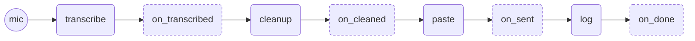

# Lifecycle hooks

A hook is a Python function that Kiku Flow calls at a fixed point in the dictation pipeline. Its input is the last step's text and its output is the next step's text:



## Your first hook

Save this as `shout.py` in the hooks folder, `~/Library/Application Support/KikuFlow/hooks/`:

```python
def on_cleaned(t):
    return t.upper()
```

Choose "Reload Kiku Flow" in the menu and dictate something. EVERYTHING YOU SAY IS NOW PASTED LIKE THIS. Delete the file and reload when the joke wears off.

Kiku Flow loads every `*.py` file in that folder. A build from source links the folder to `hooks/` in the repo, unless the folder is already there, as after an install. It looks in each file for the five names below. The rest of the file is yours: imports, constants, helpers. Reload after every edit.

## The five hooks

| Hook | Fires | Gets | What it returns becomes |
| --- | --- | --- | --- |
| `on_transcribed(t)` | after speech recognition | what you said | the text the cleanup model sees |
| `on_cleaned(t)` | after the cleanup model | the cleaned text | the text that is pasted |
| `on_sent(t)` | once the text has gone off to be pasted | the pasted text | the log entry |
| `on_done(t)` | after the log entry is written | the log entry | nothing; it returns the text, which is not used |
| `on_error(e)` | after a failure | the exception | the message shown and kept |

The first three are the text hooks, and a return from one means:

| Return | Effect |
| --- | --- |
| a string | It replaces the text. `return t` leaves it as it was. |
| `""` | The dictation stops there. |
| anything else | A `TypeError`, treated like any other [failure](#when-a-hook-fails). |

Stopping in `on_transcribed` or `on_cleaned` means nothing is pasted and nothing is logged. By `on_sent` the paste has already happened, so `""` there only keeps the dictation out of the log, and `on_done` doesn't fire.

If you said nothing, no hooks fire.

## More than one file

Files load in filename order and their hooks run in that order, each getting what the one before it returned.

A file runs once, when the app starts. Anything at module level stays put between dictations: a variable that `on_transcribed` sets is still there for `on_cleaned`, and a model loaded at the top of the file stays loaded.

Hooks run in the speech engine's own Python, so they can import the standard library and what the engine ships with, mlx-lm and NumPy included. Nothing else: that Python is re-synced at every launch, and a package you install into it is removed.

A file that fails to import stops the app from loading. You get the warning triangle, and "Open Errors" shows something like `hook file voice.py: ModuleNotFoundError: …`. Fix the file and reload.

## Performance Considerations

`on_transcribed` and `on_cleaned` run before the paste, so they slow down the transcription result. `on_sent` and `on_done` run after it. They can't slow the paste down, but the next dictation waits until they finish.

## Recipes

Each of these is a whole file. The ones that bring their own model are in [examples/](../examples/).

### Fix the words it mishears

`vocabulary.py` fixes words that speech recognition gets wrong, whatever their case, before the cleanup model sees them.

```python
import re

WORDS = {"kiko": "Kiku", "jason": "JSON", "mac os": "macOS"}  # keys in lower case
PATTERN = re.compile(r"\b(" + "|".join(map(re.escape, WORDS)) + r")\b", re.IGNORECASE)


def on_transcribed(t):
    return PATTERN.sub(lambda m: WORDS[m[0].lower()], t)
```

### Sound like a chat message

`voice.py` drops the capital at the start and the full stop at the end.

```python
def on_cleaned(t):
    t = t.removesuffix(".")
    return t[:1].lower() + t[1:]
```

### Paste the raw transcript

`verbatim.py` pastes what you said, word for word, when you start with "verbatim". The cleanup still runs; its result is dropped. The file sorts before `vocabulary.py`, so the transcript it keeps is the one from before the vocabulary fixes.

```python
raw = ""


def on_transcribed(t):
    global raw
    raw = t
    return t


def on_cleaned(t):
    first, _, rest = raw.partition(" ")
    if first.strip(",.").lower() == "verbatim":
        return rest
    return t
```

### Choose what goes in the log

A log entry is whatever `on_sent` returns. `raw_log.py` logs what you said instead of the cleaned text.

```python
raw = ""


def on_transcribed(t):
    global raw
    raw = t
    return t


def on_sent(t):
    return raw
```

`timed_log.py` puts the time on each entry.

```python
from datetime import datetime


def on_sent(t):
    return f"{datetime.now():%H:%M} {t}"
```

`private.py` keeps a dictation that starts with "private" out of the log. It is still pasted.

```python
import re


def on_sent(t):
    if re.match(r"private\b", t, re.IGNORECASE):
        return ""
    return t
```

### Keep your own archive

The log holds the last 100 dictations. `archive.py` keeps every one, with the date and time, in a file that never drops old entries.

```python
from datetime import datetime
from pathlib import Path

ARCHIVE = Path.home() / "Documents/Dictations.txt"


def on_done(t):
    with ARCHIVE.open("a", encoding="utf-8") as f:
        f.write(f"{datetime.now():%Y-%m-%d %H:%M}  {' '.join(t.split())}\n")
    return t
```

## When a hook fails

A hook that raises stops the dictation, and nothing after it runs. The message goes to `errors.txt` ("Open Errors" in the menu) as one line that says where it happened:

```
2026-11-18 14:02 on_cleaned in voice.py:3: KeyError: 'x'
```

If the failure came before the paste, the HUD shows the message too and nothing is pasted.

So a hook that calls something that can fail should catch its own errors and return the text it was given, which keeps the dictation. `polish.py` sends the cleaned text to a service of yours and pastes it unpolished when the service doesn't answer.

```python
import json
import urllib.request

URL = "http://127.0.0.1:8080/polish"


def on_cleaned(t):
    request = urllib.request.Request(URL, json.dumps({"text": t}).encode())
    try:
        with urllib.request.urlopen(request, timeout=5) as response:
            return json.load(response)["text"]
    except OSError:
        return t
```

## on_error

`on_error(e)` gets the exception from any failure in a dictation: a hook, speech recognition, the cleanup model or the log write. `e.__notes__[-1]` says which, as `on_cleaned in voice.py:3`, `speech recognition`, `cleanup model` or `log write`.

| Return | Effect |
| --- | --- |
| a string | It is the message, in the HUD and in `errors.txt`. |
| `""` | No message: nothing in the HUD, nothing in `errors.txt`. |

`on_error` hooks run in filename order and the first that does not fail decides. One that fails, by raising or by returning anything but a string, is skipped, and its own failure goes in `errors.txt`. With no `on_error` hook, or none that succeeds, the default message is used.

`offline.py` keeps network failures out of `errors.txt`, for a hook that posts somewhere and doesn't catch its own errors. `urllib` wraps the `ConnectionError` in `e.reason`. Before the paste this is a silent failure: nothing is pasted and nothing says why.

```python
def on_error(e):
    if isinstance(getattr(e, "reason", e), ConnectionError):
        return ""
    return f"{e.__notes__[-1]}: {type(e).__name__}: {e}"
```

Two failures never reach `on_error`: the models or a hook file failing to load, and the engine crashing. Both go in `errors.txt`, a run of crashes once.
