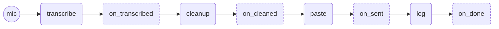

# Lifecycle hooks

A hook is a method of a plugin, a Python class in a file of yours, and Kiku Flow calls it at a fixed point in the dictation pipeline. A hook's input is the last step's text and its output is the next step's text:



## Your first hook

Save this as `shout.py` in the hooks folder, `~/Library/Application Support/KikuFlow/hooks/`:

```python
from typing import override

from kiku import Plugin


class Shout(Plugin):
    """Paste every dictation in capitals."""

    @override
    def on_cleaned(self, t: str) -> str:
        return t.upper()
```

Choose "Reload Kiku Flow" in the menu and dictate something. EVERYTHING YOU SAY IS NOW PASTED LIKE THIS. Delete the file and reload when the joke wears off.

Kiku Flow loads every `*.py` file in that folder. A build from source links the folder to `hooks/` in the repo, unless the folder is already there, as after an install. In each file it makes one of every `Plugin` subclass the file defines, with no arguments, and calls the hooks each one overrides from the five below. A hook a plugin leaves alone passes its input on. `@override` changes nothing when the hook runs, but it lets your editor catch a misspelt hook name. The rest of the file is yours: imports, constants, helpers, more classes. Reload after every edit.

## The five hooks

| Hook | Fires | Gets | What it returns becomes |
| --- | --- | --- | --- |
| `on_transcribed(t)` | after speech recognition | what you said | the text the cleanup model sees |
| `on_cleaned(t)` | after the cleanup model | the cleaned text | the text that is pasted |
| `on_sent(t)` | once the text has gone off to be pasted | the pasted text | the log entry |
| `on_done(t)` | after the log entry is written | the log entry | nothing; it returns the text, which is not used |
| `on_error(e)` | after a failure | the exception | the message shown and kept |

The first three are the text hooks, and a return from one means:

| Return | Effect |
| --- | --- |
| a string | It replaces the text. `return t` leaves it as it was. |
| `""` | The dictation stops there. |
| anything else | A `TypeError`, treated like any other [failure](#when-a-hook-fails). |

Stopping in `on_transcribed` or `on_cleaned` means nothing is pasted and nothing is logged. By `on_sent` the paste has already happened, so `""` there only keeps the dictation out of the log, and `on_done` doesn't fire.

If you said nothing, no hooks fire.

## More than one file

Files load in filename order, and the plugins in a file in the order it defines them. Hooks run in that order, each getting what the one before it returned.

A file runs when the app starts or reloads, and its plugins are made then. Each plugin stays put between dictations, so an attribute that `on_transcribed` sets on `self` is still there for `on_cleaned`. Keep constants at the top of the file, and put anything a plugin loads or changes on `self`: a model loaded in `__init__` stays loaded.

Hooks run in the speech engine's own Python, so they can import the standard library and what the engine ships with, mlx-lm and NumPy included. Nothing else: that Python is re-synced at every launch, and a package you install into it is removed.

A file that fails to import, or a plugin whose `__init__` fails, stops the app from loading. You get the warning triangle, and "Open Errors" shows something like `hook file voice.py: ModuleNotFoundError: …`. Fix the file and reload.

## Bring your own model

A plugin can ask a chat model of its own. `load_model` from `kiku` loads one by name, and `prompt` asks it:

- `self.model = load_model("mlx-community/Qwen3-4B-Instruct-2507-4bit")` in `__init__` loads the model when the app starts. The name is a Hugging Face repo in MLX format, downloaded the first time, or a folder on your Mac.
- `self.model.prompt(system, text)` in a hook returns the model's reply to `text` under your system prompt. A third argument takes examples, each a pair of what a user said and the reply to give, as `(("Mac, dark mode.", "dark mode"),)`.

A model stays in memory until you quit or reload. Plugins that name the same model share one copy, so the second costs no more memory. A different name is a different model.

`engine` says what runs the model. `"mlx"` is the default and the only one so far, so `load_model(name)` and `load_model(name, engine="mlx")` are the same call.

`load_model` is there to share a model, and nothing makes you use it. A plugin can call mlx-lm itself, or a server like Ollama, from `__init__`. [talk_like_a_pirate.py](../examples/talk_like_a_pirate.py) is the shortest plugin with a model.

## Performance Considerations

`on_transcribed` and `on_cleaned` run before the paste, so they slow down the transcription result. `on_sent` and `on_done` run after it. They can't slow the paste down, but the next dictation waits until they finish.

## Recipes

Each of these is a whole file. The ones that bring their own model are in [examples/](../examples/).

### Fix the words it mishears

`vocabulary.py` fixes words that speech recognition gets wrong, whatever their case, before the cleanup model sees them.

```python
import re
from typing import override

from kiku import Plugin

WORDS = {"kiko": "Kiku", "jason": "JSON", "mac os": "macOS"}  # keys in lower case
ALTERNATIVES = "|".join(map(re.escape, WORDS))
PATTERN = re.compile(rf"\b({ALTERNATIVES})\b", re.IGNORECASE)


def corrected(match: re.Match[str]) -> str:
    """Return the right spelling of the word that was misheard."""
    heard = match[0].lower()
    return WORDS[heard]


class Vocabulary(Plugin):
    """Fix the words that speech recognition gets wrong."""

    @override
    def on_transcribed(self, t: str) -> str:
        return PATTERN.sub(corrected, t)
```

### Sound like a chat message

`voice.py` drops the capital at the start and the full stop at the end.

```python
from typing import override

from kiku import Plugin


class ChatVoice(Plugin):
    """Paste with no capital at the start and no full stop at the end."""

    @override
    def on_cleaned(self, t: str) -> str:
        t = t.removesuffix(".")
        return t[:1].lower() + t[1:]
```

### Paste the raw transcript

`verbatim.py` pastes what you said, word for word, when you start with "verbatim". The cleanup still runs; its result is dropped. The file sorts before `vocabulary.py`, so the transcript it keeps is the one from before the vocabulary fixes.

```python
from typing import override

from kiku import Plugin


class Verbatim(Plugin):
    """Paste what you said, word for word, when you start with "verbatim"."""

    def __init__(self) -> None:
        self.raw = ""

    @override
    def on_transcribed(self, t: str) -> str:
        self.raw = t
        return t

    @override
    def on_cleaned(self, t: str) -> str:
        first, _, rest = self.raw.partition(" ")
        if first.strip(",.").lower() == "verbatim":
            return rest
        return t
```

### Choose what goes in the log

A log entry is whatever `on_sent` returns. `raw_log.py` logs what you said instead of the cleaned text.

```python
from typing import override

from kiku import Plugin


class RawLog(Plugin):
    """Log what you said instead of the cleaned text."""

    def __init__(self) -> None:
        self.raw = ""

    @override
    def on_transcribed(self, t: str) -> str:
        self.raw = t
        return t

    @override
    def on_sent(self, t: str) -> str:
        return self.raw
```

`timed_log.py` puts the time on each entry.

```python
from datetime import datetime
from typing import override

from kiku import Plugin


class TimedLog(Plugin):
    """Put the time on each log entry."""

    @override
    def on_sent(self, t: str) -> str:
        return f"{datetime.now():%H:%M} {t}"
```

`private.py` keeps a dictation that starts with "private" out of the log. It is still pasted.

```python
import re
from typing import override

from kiku import Plugin


class Private(Plugin):
    """Keep a dictation that starts with "private" out of the log."""

    @override
    def on_sent(self, t: str) -> str:
        if re.match(r"private\b", t, re.IGNORECASE):
            return ""
        return t
```

### Keep your own archive

The log holds the last 100 dictations. `archive.py` keeps every one, with the date and time, in a file that never drops old entries.

```python
from datetime import datetime
from pathlib import Path
from typing import override

from kiku import Plugin

ARCHIVE = Path.home() / "Documents/Dictations.txt"


class Archive(Plugin):
    """Keep every dictation in a file, with the date and time."""

    @override
    def on_done(self, t: str) -> str:
        one_line = " ".join(t.split())
        entry = f"{datetime.now():%Y-%m-%d %H:%M}  {one_line}\n"
        with ARCHIVE.open("a", encoding="utf-8") as f:
            f.write(entry)
        return t
```

## When a hook fails

A hook that raises stops the dictation, and nothing after it runs. The message goes to `errors.txt` ("Open Errors" in the menu) as one line that says where it happened:

```
2026-11-18 14:02 on_cleaned in voice.py:3: KeyError: 'x'
```

If the failure came before the paste, the HUD shows the message too and nothing is pasted.

So a hook that calls something that can fail should catch its own errors and return the text it was given, which keeps the dictation. `polish.py` sends the cleaned text to a service of yours and pastes it unpolished when the service doesn't answer.

```python
import json
import urllib.request
from typing import override

from kiku import Plugin

URL = "http://127.0.0.1:8080/polish"


class Polish(Plugin):
    """Paste the text as a service polished it, or as it was when there is no answer."""

    @override
    def on_cleaned(self, t: str) -> str:
        body = json.dumps({"text": t}).encode()
        request = urllib.request.Request(URL, body)
        try:
            with urllib.request.urlopen(request, timeout=5) as response:
                return json.load(response)["text"]
        except OSError:
            return t
```

## on_error

`on_error(e)` gets the exception from any failure in a dictation: a hook, speech recognition, the cleanup model or the log write. `e.__notes__[-1]` says which, as `on_cleaned in voice.py:3`, `speech recognition`, `cleanup model` or `log write`.

| Return | Effect |
| --- | --- |
| a string | It is the message, in the HUD and in `errors.txt`. |
| `""` | No message: nothing in the HUD, nothing in `errors.txt`. |
| `e` | The hook passes. The next `on_error` hook is asked, and the default message is used when none is left. |

`on_error` hooks run in the same order as the others, and the first to return a string decides. One that fails, by raising or by returning anything but a string or `e`, is skipped, and its own failure goes in `errors.txt`. With no `on_error` hook, or none that returns a string, the default message is used.

`offline.py` keeps network failures out of `errors.txt`, for a hook that posts somewhere and doesn't catch its own errors. `urllib` wraps the `ConnectionError` in `e.reason`. Before the paste this is a silent failure: nothing is pasted and nothing says why.

```python
from typing import override

from kiku import Plugin


class Offline(Plugin):
    """Keep network failures out of errors.txt."""

    @override
    def on_error(self, e: Exception) -> str | Exception:
        if isinstance(getattr(e, "reason", e), ConnectionError):
            return ""
        return e
```

Two failures never reach `on_error`: the models or a hook file failing to load, and the engine crashing. Both go in `errors.txt`, a run of crashes once.
